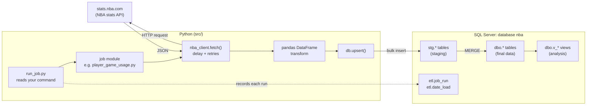
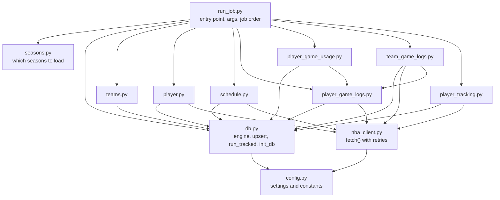
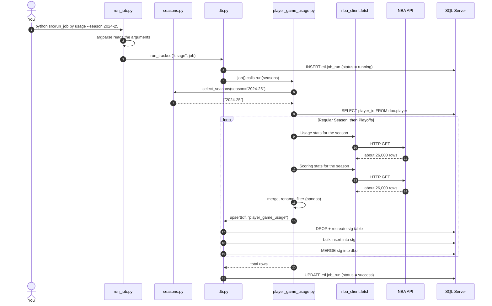
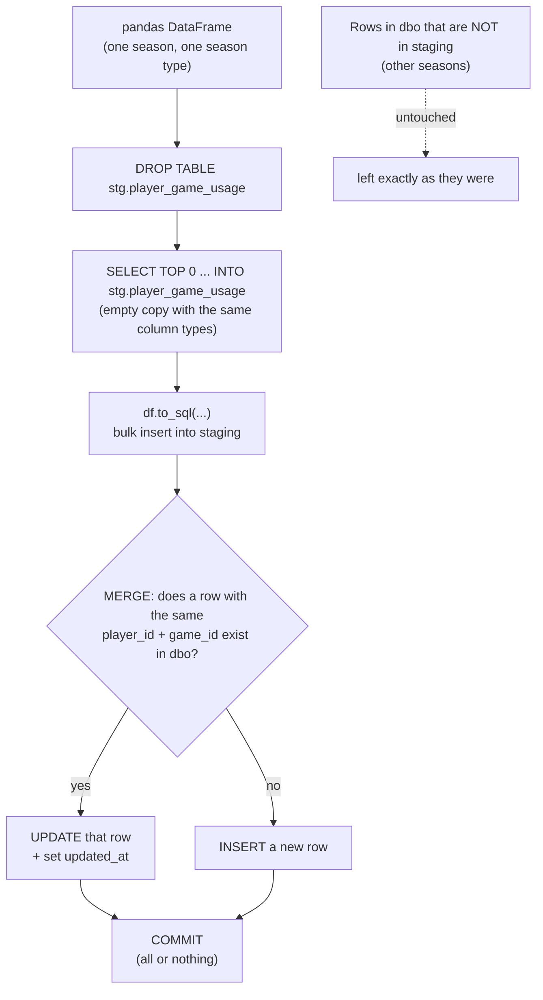
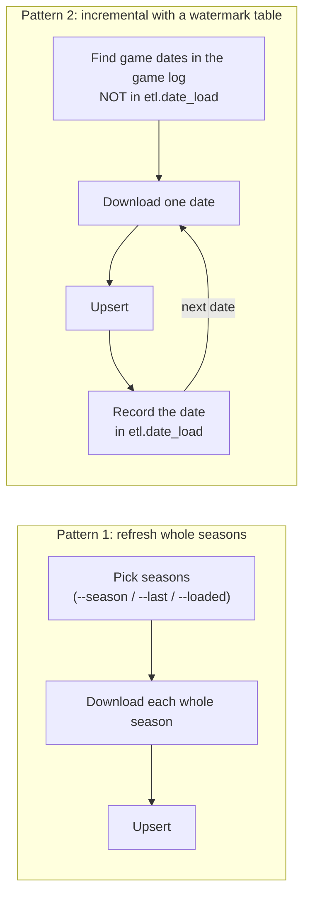
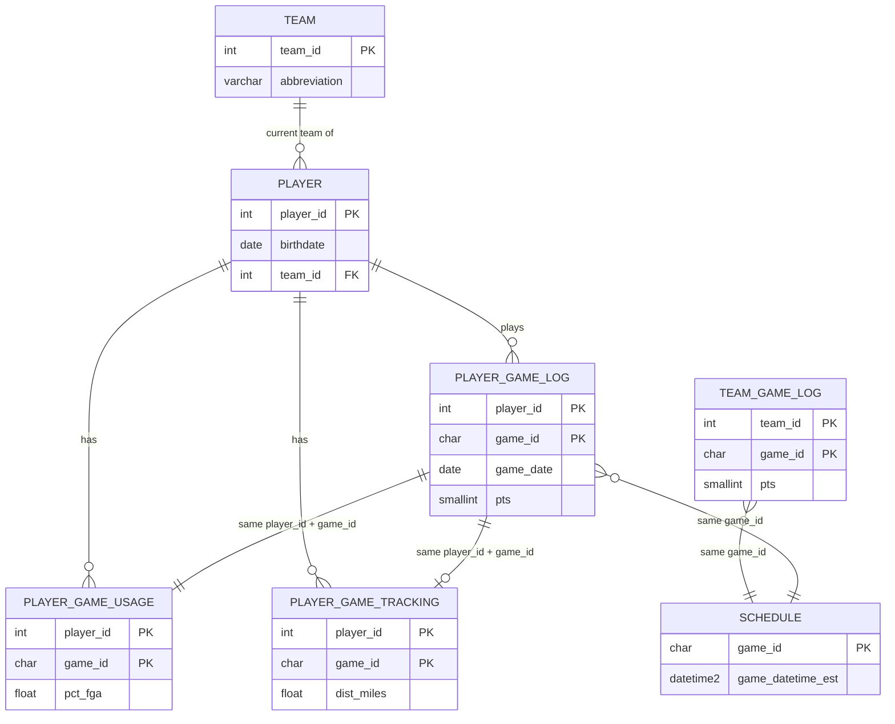
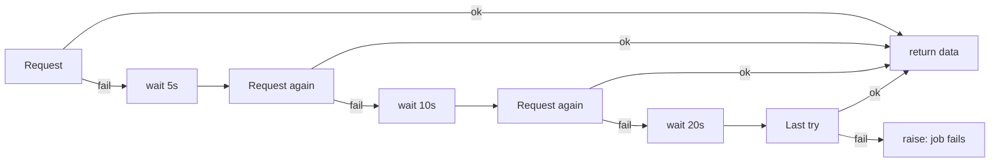
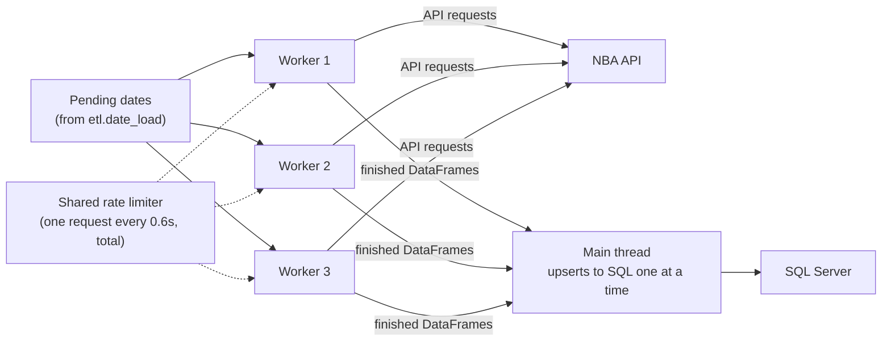

# How this ETL pipeline works: a learning guide

This guide explains the NBA pipeline from the ground up: what happens when you run a job, which Python and SQL features make it work, and why it is built the way it is. It is written for someone learning data engineering, DevSecOps and Python, so it explains the concepts as well as the code.

- For how to *run* things, see [README.md](README.md).
- For where the project is *going*, see [ROADMAP.md](ROADMAP.md).

The diagrams are written in [Mermaid](https://mermaid.js.org/). GitHub draws them automatically, and so does PyCharm's Markdown preview.

## Contents

1. [What ETL means](#1-what-etl-means)
2. [The big picture](#2-the-big-picture)
3. [Which file does what](#3-which-file-does-what)
4. [Step by step: one job from start to finish](#4-step-by-step-one-job-from-start-to-finish)
5. [The upsert, in detail](#5-the-upsert-in-detail)
6. [Two ways to load: full season refresh and incremental](#6-two-ways-to-load-full-season-refresh-and-incremental)
7. [The database: schemas, tables and constraints](#7-the-database-schemas-tables-and-constraints)
8. [Python concepts used in this project](#8-python-concepts-used-in-this-project)
9. [What to change for a new season](#9-what-to-change-for-a-new-season)
10. [Errors, retries and logging](#10-errors-retries-and-logging)
11. [Threading: why there is none yet, and how workers would come next](#11-threading-why-there-is-none-yet-and-how-workers-would-come-next)
12. [DevSecOps: what is in place and what to add](#12-devsecops-what-is-in-place-and-what-to-add)
13. [Glossary](#13-glossary)
14. [Exercises](#14-exercises)

---

## 1. What ETL means

**ETL = Extract, Transform, Load.** Almost every data pipeline does these three things:

| Stage | Meaning | In this project |
|---|---|---|
| **Extract** | Get raw data from a source | Call the NBA stats API through the `nba_api` library |
| **Transform** | Clean and reshape it into the form you want | pandas: pick columns, join two downloads, rename, fix types, filter |
| **Load** | Write it to where it will be used | Bulk copy into SQL Server, then `MERGE` into the final table |

A **job** is one ETL run for one dataset (players, game logs, usage…). A **pipeline** is the set of jobs and the order they run in.

---

## 2. The big picture



Data only ever flows one way: API → Python → staging → final tables → views. The views add the birthday logic on top of the tables without changing them.

---

## 3. Which file does what



| File | Role | Key functions |
|---|---|---|
| [src/run_job.py](src/run_job.py) | Entry point. Reads the command line and runs jobs in order | `main()` |
| [src/config.py](src/config.py) | One place for settings: server name, API delays, season types | `setup_logging()` |
| [src/seasons.py](src/seasons.py) | Season labels and choosing which seasons to load | `current_season()`, `select_seasons()` |
| [src/nba_client.py](src/nba_client.py) | Wraps every API call with a delay and retries | `fetch()` |
| [src/db.py](src/db.py) | Everything that talks to SQL Server | `get_engine()`, `upsert()`, `read_sql()`, `run_tracked()`, `init_db()` |
| [src/teams.py](src/teams.py) | Teams job (data comes bundled with `nba_api`, no request) | `build_teams_df()`, `run()` |
| [src/player.py](src/player.py) | Players job, including birthdates | `get_active_players()`, `get_player_details()`, `run()` |
| [src/schedule.py](src/schedule.py) | Schedule job | `build_schedule_df()`, `run()` |
| [src/player_game_logs.py](src/player_game_logs.py) | Player box score + advanced stats | `get_league_game_logs()`, `tidy_game_logs()`, `build_game_logs_df()`, `run()` |
| [src/player_game_usage.py](src/player_game_usage.py) | Usage and scoring splits | `build_usage_df()`, `run()` |
| [src/team_game_logs.py](src/team_game_logs.py) | Team box score + advanced stats | `build_team_logs_df()`, `run()` |
| [src/player_tracking.py](src/player_tracking.py) | Tracking, passing, touches, hustle, starters (per date) | `get_tracking_for_date()`, `run()` |
| [src/analysis.py](src/analysis.py) | Birthday-week statistics | `summarise()` |
| [sql/01_schema.sql](sql/01_schema.sql) | Creates schemas, tables, constraints, indexes | |
| [sql/02_views.sql](sql/02_views.sql), [sql/03_derived_views.sql](sql/03_derived_views.sql) | Analysis views and derived context | |

Every job module follows the **same pattern**, which makes the project easy to extend:

```python
def build_something_df(...) -> pd.DataFrame:   # Extract + Transform
    ...

def run(...) -> int:                           # Load, returns rows loaded
    df = build_something_df(...)
    return db.upsert(df, "table_name", keys=[...])
```

---

## 4. Step by step: one job from start to finish

We will follow this command all the way through:

```powershell
.venv\Scripts\python.exe src\run_job.py usage --season 2024-25
```



### Step 1: Python starts and reads your command

Running `python src\run_job.py ...` executes the file from the top. The last lines are:

```python
if __name__ == "__main__":
    sys.exit(main())
```

`__name__` is `"__main__"` only when the file is run directly, not when it is imported. So `main()` runs, and its return value (0 = success, 1 = failure) becomes the process **exit code**, which Windows Task Scheduler and CI tools use to decide if the run worked.

### Step 2: argparse turns the command line into `args`

**`args`** is the object holding what you typed after the script name. Inside `main()`:

```python
parser = argparse.ArgumentParser(description="Run NBA pipeline jobs")
parser.add_argument("job", choices=["init_db", "all"] + JOB_ORDER)   # positional: required
seasons.add_argument("--season", help="...")                         # optional, takes a value
seasons.add_argument("--last", type=int, help="...")                 # optional, converted to int
seasons.add_argument("--backfill", action="store_true", help="...")  # a flag: True if present
args = parser.parse_args()
```

For our command, `args` looks like this:

| Attribute | Value | Why |
|---|---|---|
| `args.job` | `"usage"` | The positional argument |
| `args.season` | `"2024-25"` | `--season 2024-25` |
| `args.last` | `None` | Not given |
| `args.backfill` | `False` | `store_true` flags default to `False` |
| `args.loaded` | `False` | |
| `args.limit` | `None` | |

argparse also gives you `--help` for free and rejects bad input (`run_job.py usagee` fails with a clear message, because `choices=` lists the valid jobs).

> **Don't confuse** command-line `args` with Python's `*args` and `**kwargs`, which are about passing arguments to *functions*. Both appear in this project; see [section 8](#args-and-kwargs-in-functions).

### Step 3: the job is looked up in a dictionary

```python
jobs = {
    "teams": teams.run,
    "players": player.run,
    "usage": lambda: player_game_usage.run(chosen_seasons()),
    ...
}
for name in JOB_ORDER if args.job == "all" else [args.job]:
    db.run_tracked(name, jobs[name])
```

- The **dictionary** maps a job name to a function. `jobs["usage"]` gives back the function without calling it.
- **`lambda: ...`** creates a tiny function with no name. It is used so the call `player_game_usage.run(chosen_seasons())` is *delayed* until the job actually runs. Without it, every job's seasons would be worked out up front.
- `JOB_ORDER` is a **list**, so `all` runs the jobs in a fixed order: teams before players, players before game logs. That order matters because of the foreign keys explained in [section 7](#7-the-database-schemas-tables-and-constraints).

### Step 4: run_tracked records the run

[`db.run_tracked()`](src/db.py) is a wrapper around every job:

```python
run_id = conn.execute(
    text("INSERT INTO etl.job_run (job_name, status) OUTPUT INSERTED.run_id VALUES (:job, 'running')"),
    {"job": job_name},
).scalar_one()
try:
    rows = job()                         # the actual job runs here
except Exception as e:
    ... UPDATE etl.job_run SET status = 'failed', message = ...
    raise
... UPDATE etl.job_run SET status = 'success', rows_loaded = ...
```

- `OUTPUT INSERTED.run_id` makes SQL Server hand back the new row's id, so the same row can be updated at the end.
- `:job` is a **bind parameter**. The value is sent separately from the SQL text, which is the safe way to put values into SQL (see [section 12](#12-devsecops-what-is-in-place-and-what-to-add)).
- `raise` with no argument re-throws the same error after recording it, so the failure still reaches `main()`.

### Step 5: choose the seasons

[`select_seasons()`](src/seasons.py) turns options into a list of season labels:

| Option | Result |
|---|---|
| `--loaded` | Every season already in `dbo.player_game_log` |
| `--backfill` | Every season since the earliest `from_year` in `dbo.player` |
| `--last 3` | The current season and the two before it |
| `--season 2024-25` | `["2024-25"]` |
| nothing | `[current_season()]` |

### Step 6: Extract

[`player_game_usage.run()`](src/player_game_usage.py) loops over seasons and season types and calls `build_usage_df()`, which calls `get_league_game_logs()`, which calls `fetch()`:

```python
def get_league_game_logs(season, season_type, measure_type):
    return fetch(
        PlayerGameLogs,                                   # the nba_api endpoint class
        season_nullable=season,
        season_type_nullable=season_type,
        measure_type_player_game_logs_nullable=measure_type,
    ).player_game_logs.get_data_frame()
```

No player is specified, so **one request returns every player's games for the whole season**. This is the most important efficiency decision in the project: 4 requests per season instead of thousands.

### Step 7: Transform

```python
df = usage[KEY_COLUMNS + USAGE_COLUMNS].merge(       # keep only the columns we want
    scoring[KEY_COLUMNS + SCORING_COLUMNS],
    on=KEY_COLUMNS,                                  # join on PLAYER_ID + GAME_ID
    how="left",                                      # like SQL LEFT JOIN
)
df.columns = df.columns.str.lower()                  # PCT_FGA -> pct_fga
...
df = df[df["player_id"].isin(player_ids)]            # keep only players in dbo.player
```

| pandas operation | SQL equivalent |
|---|---|
| `df[["a", "b"]]` | `SELECT a, b` |
| `df.merge(other, on=..., how="left")` | `LEFT JOIN other ON ...` |
| `df[df["x"].isin(values)]` | `WHERE x IN (...)` |
| `df.rename(columns={...})` | `SELECT old AS new` |
| `df.groupby(...).agg(...)` | `GROUP BY` |

Other jobs do more transformation. For example, [`tidy_game_logs()`](src/player_game_logs.py) turns `"LAL @ BOS"` into `is_home = False` and `opponent_abbreviation = "BOS"`, and converts text dates into real dates.

### Step 8: Load

`db.upsert(df, "player_game_usage", keys=["player_id", "game_id"])` writes the DataFrame into SQL Server. That is important enough to get its own section.

---

## 5. The upsert, in detail

An **upsert** means: *update* the row if it already exists, *insert* it if it does not. It is what makes every job safe to re-run.



The code, from [src/db.py](src/db.py):

```python
def upsert(df, table, keys, schema="dbo"):
    if df.empty:
        return 0

    columns = list(df.columns)
    column_list = ", ".join(f"[{c}]" for c in columns)
    on_clause = " AND ".join(f"t.[{k}] = s.[{k}]" for k in keys)
    set_clause = ", ".join(f"t.[{c}] = s.[{c}]" for c in columns if c not in keys)
    insert_values = ", ".join(f"s.[{c}]" for c in columns)

    with get_engine().begin() as conn:          # one transaction
        conn.execute(text(f"DROP TABLE IF EXISTS stg.[{table}]"))
        conn.execute(text(f"SELECT TOP 0 {column_list} INTO stg.[{table}] FROM {schema}.[{table}]"))
        df.to_sql(table, conn, schema="stg", if_exists="append", index=False, chunksize=10_000)
        conn.execute(text(f"""
            MERGE {schema}.[{table}] AS t
            USING stg.[{table}] AS s ON {on_clause}
            WHEN MATCHED THEN
                UPDATE SET {set_clause}, t.updated_at = SYSUTCDATETIME()
            WHEN NOT MATCHED BY TARGET THEN
                INSERT ({column_list}) VALUES ({insert_values});
        """))
    return len(df)
```

### Why each piece is there

| Piece | Why |
|---|---|
| `if df.empty: return 0` | Nothing to do (e.g. a season that hasn't started) |
| The `", ".join(...)` lines | **Generate** SQL from the DataFrame's column names, so one function works for every table |
| `get_engine().begin()` | Opens a **transaction**. If anything inside fails, everything inside is rolled back, so the table is never left half-loaded |
| `stg` schema | A **staging** area. Loading into a scratch table first means the real table only changes in one final, atomic step |
| `SELECT TOP 0 ... INTO` | Creates the staging table with exactly the real table's column types. Otherwise pandas would guess them, and guesses like "text of unlimited length" are slow and can break the MERGE |
| `to_sql(..., chunksize=10_000)` | Bulk-inserts in batches. `fast_executemany=True` in `get_engine()` makes pyodbc send each batch in one round trip instead of one per row |
| `MERGE ... WHEN MATCHED` | Row exists, so update it |
| `MERGE ... WHEN NOT MATCHED BY TARGET` | Row is new, so insert it |
| No `WHEN NOT MATCHED BY SOURCE` | Deliberately missing. That clause would **delete** rows not in the download, wiping every season you didn't reload |
| `updated_at = SYSUTCDATETIME()` | Records when each row last changed, so you can see what a run touched |

### What this means when you run a job

| You run | What happens to the table |
|---|---|
| `usage` (no options) | Current season's rows are inserted or updated. Older seasons untouched |
| `usage --season 2024-25` | That season's rows are updated in place (new `updated_at`), nothing duplicated |
| The same command twice | Same end result as running it once |
| Nothing is ever deleted | To fully reload, run `TRUNCATE TABLE dbo.player_game_usage` yourself first |

"Same result no matter how many times you run it" is called **idempotency**. It is one of the most valuable properties a pipeline can have: after a crash you just run it again.

### A partial upsert trick

`upsert` only touches the columns present in the DataFrame. [`player.run()`](src/player.py) uses this: first it upserts the basic player list (name, team…), then later upserts *only* `player_id, birthdate, position, height, weight_lbs, country` for players missing a birthdate. The second upsert fills in those columns without overwriting the names.

---

## 6. Two ways to load: full season refresh and incremental



| | Pattern 1: season refresh | Pattern 2: incremental |
|---|---|---|
| Used by | `schedule`, `game_logs`, `usage`, `team_logs` | `tracking`, and birthdates in `players` |
| How it knows what to load | You tell it which seasons | It works out what's missing |
| Cost of a re-run | Re-downloads whole seasons (cheap: 4 requests each) | Only fetches what's new |
| Why chosen | A whole season is one or two requests, so simple wins | 5 requests per date × 1,600 dates: re-doing it would take hours |
| If interrupted | Run again; finished chunks are already saved | Run again; it carries on from the next unloaded date |

`etl.date_load` is a **watermark** or **checkpoint** table: a record of progress kept separately from the data. The tracking job records a date there only *after* its rows are saved, so a crash never marks a date done that wasn't.

---

## 7. The database: schemas, tables and constraints

### Schemas

A **schema** is a folder inside the database that groups related tables.

| Schema | Holds |
|---|---|
| `dbo` | The real data, plus views |
| `stg` | Staging tables, rebuilt on every load |
| `etl` | The pipeline's own records: `job_run`, `date_load` |

### How the tables relate



### Constraints

A **constraint** is a rule the database enforces no matter what the code does. They are your last line of defence against bad data. All of them are in [sql/01_schema.sql](sql/01_schema.sql).

| Type | Example | What it guarantees |
|---|---|---|
| **PRIMARY KEY** | `pk_player_game_log PRIMARY KEY (player_id, game_id)` | No two rows with the same player and game. Even a bug in the code cannot create a duplicate. Also creates an index, so lookups by key are fast |
| **Composite key** | `(player_id, game_id)` | A key made of two columns: a player appears in many games, a game has many players, but each pair is unique |
| **FOREIGN KEY** | `fk_log_player REFERENCES dbo.player (player_id)` | A game log row cannot point at a player who doesn't exist. This is why `players` must load before `game_logs`, and why the jobs filter with `isin(player_ids)` |
| **NOT NULL** | `game_date DATE NOT NULL` | The column must always have a value |
| **DEFAULT** | `df_log_updated DEFAULT SYSUTCDATETIME()` | Fills in a value if the insert doesn't give one |
| **IDENTITY** | `run_id INT IDENTITY(1, 1)` | SQL Server numbers the rows itself: 1, 2, 3… |
| **Computed column** | `birthdate_mdy AS CONVERT(CHAR(10), birthdate, 110)` | Calculated from another column, so it can never be out of sync |

Constraints are **named** (`pk_...`, `fk_...`, `df_...`). Unnamed ones get random names from SQL Server, which makes error messages and later changes harder.

**Indexes** (`ix_...`) are not rules but speed-ups: like a book's index, they let SQL Server find rows without reading the whole table. `ix_player_game_log_player_date` exists because the views often look up "this player's games in date order".

### The SQL scripts are re-runnable

Every object is created only if missing:

```sql
IF OBJECT_ID('dbo.team') IS NULL
CREATE TABLE dbo.team (...);

CREATE OR ALTER VIEW dbo.v_player_game_birthday AS ...
```

So `init_db` can run any number of times, and adding a new table is just adding a block to the file. Tools like Flyway, Liquibase or Alembic do this more formally ("database migrations"), and are worth learning later.

### `GO`

`GO` in the SQL files is not SQL. It is a **batch separator** understood by SSMS and sqlcmd. Some statements, like `CREATE VIEW`, must be first in their batch. [`init_db()`](src/db.py) splits the files on `GO` with a regular expression and runs each batch separately:

```python
batches = re.split(r"^\s*GO\s*$", path.read_text(), flags=re.MULTILINE | re.IGNORECASE)
```

---

## 8. Python concepts used in this project

### Modules and imports

Each `.py` file is a **module**. `import db` runs `db.py` once and gives you its functions as `db.upsert`, `db.read_sql`… `from player_game_logs import KEY_COLUMNS` imports one name directly. Reusing functions across modules (usage and team logs reuse game-log helpers) avoids copy-pasted code.

### Constants

Names in `UPPER_CASE` are **constants** by convention: values that don't change while the program runs. Python doesn't enforce it, but everyone reads it that way.

| Constant | File | Purpose |
|---|---|---|
| `SERVER`, `DATABASE`, `DRIVER` | config.py | Where the database is |
| `REQUEST_DELAY_SECONDS = 0.6` | config.py | Pause after each API call |
| `REQUEST_TIMEOUT_SECONDS = 60` | config.py | Give up on a request after this long |
| `MAX_RETRIES = 4`, `RETRY_BACKOFF_SECONDS = 5` | config.py | Retry policy |
| `SEASON_TYPES` | config.py | `["Regular Season", "Playoffs"]` |
| `JOB_ORDER` | run_job.py | Order jobs run in for `all` |
| `KEY_COLUMNS`, `BASE_STAT_COLUMNS`, `ADVANCED_STAT_COLUMNS`… | player_game_logs.py | Which API columns to keep |
| `USAGE_COLUMNS`, `SCORING_COLUMNS` | player_game_usage.py | Same, for usage |
| `FIRST_TRACKING_SEASON`, `FIRST_HUSTLE_SEASON` | player_tracking.py | When those stats begin |
| `DETAILS_BATCH_SIZE = 50` | player.py | Birthdates saved every 50 players |

Keeping them at the top of a file means one change updates every use.

### Environment variables

```python
SERVER = os.getenv("NBA_SQL_SERVER", "localhost")
```

Reads a setting from the environment, falling back to `"localhost"`. Configuration that differs between machines (laptop, test server, production) belongs in environment variables, not in code. It's also where secrets like passwords go (see [section 12](#12-devsecops-what-is-in-place-and-what-to-add)).

### Dictionaries used in the project

A **dict** maps keys to values: `{"key": value}`.

| Dict | Where | Maps |
|---|---|---|
| `jobs` | run_job.py | job name → function to run |
| `COLUMNS` | schedule.py | API column name → our column name (passed to `df.rename(columns=COLUMNS)`) |
| `PT_MEASURES` | player_tracking.py | tracking stat set name → columns to keep. The code loops over it: `for measure in PT_MEASURES` |
| Rename dict | player.py `get_active_players()` | `"PERSON_ID"` → `"player_id"` and so on |
| Bind parameters | db.py, player_tracking.py | `{"job": job_name}`, `{"game_date": ...}`: values for `:name` placeholders in SQL |
| `**params` | nba_client.py | Keyword arguments collected into a dict (next section) |
| `df.attrs` | player_tracking.py | pandas' spare dict on a DataFrame, used to carry the set of starter ids alongside the stats |

### `*args` and `**kwargs` in functions

```python
def fetch(endpoint, **params):
    result = endpoint(timeout=config.REQUEST_TIMEOUT_SECONDS, **params)
```

- In a definition, `**params` **collects** any keyword arguments into a dict. Calling `fetch(PlayerGameLogs, season_nullable="2024-25")` makes `params == {"season_nullable": "2024-25"}`.
- In a call, `**params` **spreads** the dict back out into keyword arguments.

So `fetch` works with every endpoint without knowing their parameters. `*args` is the same idea for positional arguments, collected into a tuple. This project doesn't use `*args`.

### Functions as values, and lambda

Functions are objects: `jobs["teams"] = teams.run` stores the function without calling it, and `job()` calls it later. `lambda: player_game_usage.run(chosen_seasons())` is a one-line function, used when the call needs arguments but must wait.

### Comprehensions and generators

```python
OUTPUT_COLUMNS = [c.lower() for c in KEY_COLUMNS + USAGE_COLUMNS]                  # list comprehension
on_clause = " AND ".join(f"t.[{k}] = s.[{k}]" for k in keys)                        # generator expression
return sum(db.upsert(build_schedule_df(s), "schedule", keys=["game_id"]) for s in seasons)
```

A **list comprehension** builds a list in one line. A **generator expression** (round brackets, or inside a function call) produces values one at a time without building the whole list first.

### f-strings

`f"{season} {season_type}: {len(df)} usage rows"` puts values into text. Use them for log messages and for SQL *names* you control, but **never** for SQL *values* from outside (see [section 12](#12-devsecops-what-is-in-place-and-what-to-add)).

### Type hints

```python
def upsert(df: pd.DataFrame, table: str, keys: list, schema: str = "dbo") -> int:
```

`df: pd.DataFrame` says what type is expected and `-> int` what comes back. Python doesn't enforce them at run time, but editors use them for autocomplete and tools like `mypy` check them. `schema: str = "dbo"` is a **default argument value**.

### Context managers: `with`

```python
with get_engine().begin() as conn:
    ...
```

`with` guarantees clean-up. Here it **commits** the transaction if the block finishes, **rolls back** if an error escapes, and always returns the connection to the pool. You'll also see `engine.connect()` (no automatic commit, used for reads) versus `engine.begin()` (a transaction, used for writes).

### Decorators: `@lru_cache`

```python
@lru_cache
def get_engine(database: str = config.DATABASE) -> Engine:
```

A **decorator** wraps a function to add behaviour. `lru_cache` remembers results: the first call creates the engine (and its connection pool), and later calls with the same argument return that same engine instead of building a new one.

### Exceptions

```python
try:
    rows = job()
except Exception as e:
    ...record the failure...
    raise
```

`try` / `except` catches errors. `raise` on its own re-throws the caught error. `raise RuntimeError("dbo.player is empty - run the players job first")` creates your own error with a helpful message, which is better than letting the job fail later with something confusing.

### Sets

`set(df["PLAYER_ID"])` in the tracking job. A set holds unique values and checks "is X in it?" very fast, ideal for "is this player a starter?".

### pandas types worth knowing

- `astype("Int64")` (capital I) is pandas' integer type that **allows missing values**. Plain `int64` can't hold missing values, so pandas would silently turn the column into floats (`23.0`).
- `.mask(condition)` replaces values with missing where the condition is true: `team_id` 0 becomes empty for free agents.
- `pd.to_datetime(...).dt.date` turns text into real dates.

---

## 9. What to change for a new season

**Nothing.** The current season is calculated from today's date in [src/seasons.py](src/seasons.py):

```python
def current_season() -> str:
    today = date.today()
    start_year = today.year if today.month >= 10 else today.year - 1
    return season_label(start_year)
```

From 1 October onwards it returns the new season (in October 2026 that's `"2026-27"`); from January to September it returns the season that started the previous October. Every job's default ("no option") uses this, so the daily `all` run moves to the new season by itself.

Settings you *might* want to change:

| Setting | File | Change it when |
|---|---|---|
| `SEASON_TYPES` | config.py | To add `"Pre Season"` or `"PlayIn"` |
| `REQUEST_DELAY_SECONDS` | config.py | The API starts timing out (raise it) |
| `FIRST_TRACKING_SEASON`, `FIRST_HUSTLE_SEASON` | player_tracking.py | Never, unless the NBA publishes older data |
| `NBA_SQL_SERVER` etc. | environment variable | Moving to another SQL Server |

An earlier version of [src/schedule.py](src/schedule.py) had `SEASON = "2026-27"` written into the code, which would have needed editing every year. Calculating values like this, instead of hard-coding them, is a habit worth building.

---

## 10. Errors, retries and logging

### Retries with exponential backoff

[`fetch()`](src/nba_client.py):

```python
for attempt in range(1, config.MAX_RETRIES + 1):
    try:
        result = endpoint(timeout=config.REQUEST_TIMEOUT_SECONDS, **params)
        time.sleep(config.REQUEST_DELAY_SECONDS)
        return result
    except Exception as e:
        if attempt == config.MAX_RETRIES:
            raise
        wait = config.RETRY_BACKOFF_SECONDS * 2 ** (attempt - 1)    # 5, 10, 20 seconds
        time.sleep(wait)
        NBAStatsHTTP.set_session(None)                             # fresh connection
```



- **Exponential backoff:** each wait doubles. If the server is overloaded, hammering it makes things worse; backing off gives it room.
- **Fresh session:** found the hard way on day one. `nba_api` reuses one HTTP connection, and after a few hundred requests the NBA server stopped answering on it. Throwing the session away forces a new connection.

### Logging

```python
logger = logging.getLogger(__name__)
logger.info(f"{season} {season_type}: {len(df)} usage rows")
```

- `config.setup_logging()` sends every message to the screen **and** to `logs/nba_pipeline.log`.
- `__name__` is the module name, so each line shows where it came from (`player_game_usage`, `db`…).
- Levels: `INFO` (normal progress), `WARNING` (a retry), `ERROR` (a failure). `logger.exception(...)` also writes the full traceback.
- Logging beats `print()` because it adds timestamps and levels, can go to files, and can be turned up or down without editing code.

### Three layers of "what happened?"

| Layer | Where | Answers |
|---|---|---|
| Log file | `logs/nba_pipeline.log` | Detailed step-by-step history, including retries |
| `etl.job_run` | SQL Server | Each run's status, timing and row count; easy to query |
| Exit code | `sys.exit(main())` | 0 or 1, for Task Scheduler or a CI system |

This is the beginning of **observability**: being able to tell what a system is doing from the outside.

---

## 11. Threading: why there is none yet, and how workers would come next

### Today: everything runs in one thread, one step at a time

There is **no threading** in this project. Every request, transform and load happens one after another:

```mermaid
gantt
    title Today: one date of the tracking job, done in sequence
    dateFormat X
    axisFormat %Ss
    section Main thread
    speed/distance request :0, 1
    passing request        :1, 2
    possessions request    :2, 3
    hustle request         :3, 4
    starters request       :4, 5
    upsert to SQL          :5, 6
```



That is a deliberate choice:

1. **The API is the bottleneck, and it punishes speed.** stats.nba.com throttles clients that send too many requests. Going faster risks being blocked.
2. **Simple is easier to debug.** With one thread, the log reads top to bottom in the order things happened.
3. **Most jobs are already fast.** Season-level jobs take seconds. Only `tracking` is slow.

### Concepts to know first

| Concept | Meaning |
|---|---|
| **Thread** | A separate line of execution inside one program, sharing its memory |
| **Process** | A separate program with its own memory |
| **I/O-bound** | Spends its time waiting for network or disk. This pipeline is I/O-bound: most of the time is spent waiting for the API to answer |
| **CPU-bound** | Spends its time calculating |
| **GIL** | Python's Global Interpreter Lock: only one thread runs Python code at a time. That makes threads useless for CPU-bound work, but **fine for I/O-bound work**, because a thread waiting on the network releases the lock |
| **Worker** | A thread or process that takes tasks from a queue and does them |
| **Race condition** | A bug where two threads change the same thing at once and the result depends on timing |

So for this pipeline, **threads would help** (it's I/O-bound), but only if the total request rate stays polite.

### What threading would look like: the next step

The tracking job's dates are independent of each other, which makes them a natural fit for a **worker pool**. The safe shape for this project:



- **Workers only download.** Several requests can be waiting on the network at the same time.
- **A shared rate limiter** keeps the *total* rate the same as today, so the API sees no difference. The speed-up comes from overlapping the waiting, not from sending more.
- **The main thread does all database writes**, one at a time, so two threads never upsert into the same staging table at once (that would be a race condition, because they share `stg.player_game_tracking`).

A sketch of how that could be written. This is **not in the project yet**:

```python
import threading
import time
from concurrent.futures import ThreadPoolExecutor, as_completed


class RateLimiter:
    """At most one request every `interval` seconds, across all threads."""

    def __init__(self, interval: float):
        self.interval = interval
        self.lock = threading.Lock()      # only one thread at a time may update next_time
        self.next_time = 0.0

    def wait(self) -> None:
        with self.lock:
            now = time.monotonic()
            delay = self.next_time - now
            self.next_time = max(now, self.next_time) + self.interval
        if delay > 0:
            time.sleep(delay)             # sleep outside the lock so other threads can queue up


def run_parallel(pending_dates, workers: int = 3):
    with ThreadPoolExecutor(max_workers=workers) as pool:
        futures = {pool.submit(get_tracking_for_date, d.game_date, d.season, d.season_type): d
                   for d in pending_dates}
        for future in as_completed(futures):      # results arrive in whatever order they finish
            date_row = futures[future]
            stats = future.result()               # re-raises the worker's error, if any
            ...upsert and record in etl.date_load, here in the main thread...
```

Things that would need care before doing this for real:

- `nba_api` keeps **one HTTP session shared by every thread**, and `requests.Session` is not guaranteed thread-safe. Each worker would need its own session.
- `fetch()` sleeps after each call; that would move into the shared `RateLimiter`.
- Results arrive **out of date order**, which is fine because `etl.date_load` records each date individually.
- Realistic gain: the per-request network wait overlaps, so perhaps 2-3× faster. More workers than that just queue at the rate limiter.

### Beyond threads: orchestrators and distributed workers

Threads speed up one job. As pipelines grow, data engineers use **orchestrators** to schedule many jobs, manage dependencies between them, retry failures and show it all in a dashboard:

| Tool | What it is | How this project maps to it |
|---|---|---|
| Windows Task Scheduler | What this project uses (`scripts/register_scheduled_task.ps1`) | Runs `all` daily |
| **Apache Airflow** | The industry standard orchestrator. Pipelines are DAGs (graphs of tasks) written in Python | Each job becomes a task; `JOB_ORDER` becomes task dependencies |
| **Prefect**, **Dagster** | Newer, more Python-friendly orchestrators | Same idea, less setup |
| **Celery**, **RQ** | Task queues with separate worker processes, often on other machines | The "workers" idea taken across machines |

A good learning path: (1) add the thread pool to the tracking job, (2) run the pipeline under Prefect or Dagster locally, (3) learn Airflow, which most data engineering job ads mention.

---

## 12. DevSecOps: what is in place and what to add

DevSecOps means building security and automation into everyday development instead of bolting it on at the end.

### Already in place

| Practice | Where | Why it matters |
|---|---|---|
| **No passwords in code** | `trusted_connection=yes` in `get_engine()` | Uses your Windows login. Nothing secret can leak through git |
| **Secrets and junk kept out of git** | `.gitignore`: `.env`, `.venv/`, `logs/`, `*.csv` | `.env` is where secrets would go; logs and data don't belong in source control |
| **Config from environment variables** | `os.getenv(...)` in config.py | The same code runs anywhere without edits |
| **Bind parameters for values** | `text("... WHERE game_date = :game_date")`, `bindparam("ids", expanding=True)` | Values are sent separately from the SQL text, so they can never be run as SQL. This is **the** defence against SQL injection |
| **Transactions** | `engine.begin()` in `upsert` | A failure can't leave half-written data |
| **Constraints** | Primary and foreign keys | The database rejects bad data even if the code is wrong |
| **Audit trail** | `etl.job_run`, `updated_at` columns, log file | You can see what ran, when, and what it changed |
| **Exit codes** | `sys.exit(main())` | Automation can detect failures |

### SQL injection, and an honest look at this code

**SQL injection** is when text from outside ends up *inside* a SQL statement and gets run. The classic example:

```python
# DANGEROUS: never do this with input from a user, file or API
conn.execute(text(f"SELECT * FROM dbo.player WHERE full_name = '{name}'"))
# if name is:  x'; DROP TABLE dbo.player; --   the table is gone

# SAFE: a bind parameter
conn.execute(text("SELECT * FROM dbo.player WHERE full_name = :name"), {"name": name})
```

This project builds some SQL with f-strings: `upsert()` puts **table and column names** into the MERGE, and the tracking job puts its own constants into a query. That is acceptable here because every one of those values comes from the code itself, never from the command line, a file or the API. Bind parameters can't be used for names anyway, only for values. The rule to remember: **f-strings for names you control, bind parameters for every value.** If this ever took table names from users, it would need an allow-list.

### What to add next

| Step | Tool | What it gives you |
|---|---|---|
| Pin exact versions | `pip freeze > requirements.lock` | `requirements.txt` says `pandas>=3.0`; a future release could break or compromise the build. Pinning makes installs repeatable |
| Scan dependencies for known vulnerabilities | `pip-audit` | Flags packages with published security issues |
| Lint and format | `ruff` | Catches bugs and style issues automatically |
| Security lint | `bandit` | Flags risky Python patterns. It will flag the f-string SQL above, a good exercise in judging a finding |
| Tests | `pytest` | E.g. test `current_season()`, `season_label()`, and that `tidy_game_logs()` parses `"LAL @ BOS"` correctly |
| Pre-commit hooks | `pre-commit` | Runs ruff, bandit and a secret scanner before every commit |
| Continuous integration | GitHub Actions (`.github/workflows/` exists, empty) | Runs the tests and scans on every push |
| Secret scanning | GitHub secret scanning, `gitleaks` | Catches a password committed by mistake |
| Least privilege | A SQL login with only the rights the pipeline needs | The pipeline currently runs as you, likely a database admin. A dedicated login limits the damage if anything goes wrong |
| Containers | Docker | Package Python and its dependencies so the pipeline runs the same everywhere |

A first GitHub Actions workflow would be about 20 lines: check out the code, install Python, `pip install -r requirements.txt ruff pytest pip-audit`, then run `ruff check`, `pytest` and `pip-audit`. That's a good first DevSecOps project on this repo.

---

## 13. Glossary

| Term | Meaning |
|---|---|
| **API** | A way for programs to request data from another system; here, stats.nba.com |
| **Endpoint** | One specific API address/function, such as `PlayerGameLogs` |
| **DataFrame** | pandas' in-memory table |
| **Engine** | SQLAlchemy's object that knows how to connect to the database and keeps a pool of connections |
| **Connection pool** | Reusable open connections, because opening a new one each time is slow |
| **Transaction** | A group of statements that all succeed or all fail together |
| **Commit / rollback** | Make a transaction's changes permanent / undo them |
| **Staging table** | A temporary landing table between the source and the final table |
| **MERGE** | A SQL statement that inserts, updates (and optionally deletes) in one go by comparing two tables |
| **Upsert** | Update if exists, insert if not |
| **Idempotent** | Running it again gives the same result |
| **Incremental load** | Loading only what is new since last time |
| **Watermark / checkpoint** | A record of how far a load has got (`etl.date_load`) |
| **Backfill** | Loading historical data, as opposed to the daily update |
| **Primary key** | Column(s) that uniquely identify a row |
| **Foreign key** | A column that must match a primary key in another table |
| **Index** | A structure that makes lookups faster |
| **Schema** | A named group of tables inside a database (`dbo`, `stg`, `etl`) |
| **View** | A saved query you can select from like a table |
| **Backoff** | Waiting longer between each retry |
| **Rate limiting** | Capping how many requests are sent per second |
| **Orchestrator** | A tool that schedules jobs and manages their dependencies (Airflow, Prefect, Dagster) |
| **Exit code** | A number a program returns when it ends: 0 means success |

---

## 14. Exercises

Each one builds a real skill on this codebase. Try them in order.

1. **Trace a run.** Run `.venv\Scripts\python.exe src\run_job.py team_logs --season 2024-25`, then find its row in `etl.job_run`, its lines in `logs/nba_pipeline.log`, and its last chunk in `stg.team_game_log`.
2. **Prove idempotency.** Count rows in `dbo.team_game_log`, run the same command again, count again. Then check `MAX(updated_at)`.
3. **Break it on purpose.** Temporarily set `REQUEST_TIMEOUT_SECONDS = 0.001` in config.py, run a job, and watch the retries and the `failed` row in `etl.job_run`. Then change it back.
4. **Write a test.** Install `pytest`, create `tests/test_seasons.py`, and test that `season_label(2024)` returns `"2024-25"`.
5. **Add a column.** The API returns `BLKA` (shots of yours that got blocked) and `PFD` (fouls drawn) in the Base game logs, but the project doesn't keep them. Add one to `dbo.player_game_log`: an `ALTER TABLE` in `sql/01_schema.sql`, then the column list in `player_game_logs.py`. Run `init_db`, then the job, and notice how few places had to change.
6. **Read a query plan.** In SSMS, turn on "Include Actual Execution Plan" and run a query against `dbo.v_team_game_absences`. See which indexes it uses.
7. **Run a security scan.** `pip install bandit` then `bandit -r src`. For each finding, decide whether it's a real risk and why.
8. **Add CI.** Create `.github/workflows/ci.yml` that installs dependencies and runs `ruff check src` on every push.
9. **Add the thread pool.** Implement section 11's sketch for the tracking job with 2 workers, and compare the time for `--limit 20` before and after.
