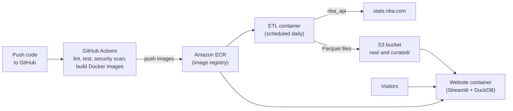

# Roadmap: modelling the birthday effect, and taking it to the cloud

What we are working on next, in two tracks:

- **Analysis track:** the data behind the question, the models to try, and the order to do it in.
- **App and cloud track:** turning the pipeline into a website on AWS, built and deployed with GitHub Actions and Docker. See [Taking it to the cloud](#taking-it-to-the-cloud).

The two tracks are independent: either can move forward without the other. For how the pipeline works and how to run it, see [README.md](README.md); for a step-by-step explanation of the code, see [ETL_GUIDE.md](ETL_GUIDE.md).

_Status as of 18 October 2026._

## The question

Do active NBA players perform differently around their birthday, and if so, why? Two explanations are on the table, and they predict different things:

| Explanation | What we would expect to see | When |
|---|---|---|
| **Teammates feed him** | More volume: higher usage, a bigger share of the team's shots and points, more assisted baskets. Efficiency about the same. | On the birthday itself |
| **He partied and is tired** | Worse quality: lower shooting efficiency, fewer minutes, more turnovers, less distance covered, slower speed, fewer hustle plays. | The game or two after |

Both could be true at once and cancel out in a whole-week average, so the analysis splits the window into **before**, **on** and **after** the birthday instead of treating the week as one block.

## Datasets

### Loaded

| Dataset | Table | Coverage | Used for |
|---|---|---|---|
| Players and birthdates | `dbo.player` | 622 active players | The birthday itself, age |
| Player game logs, box score and advanced | `dbo.player_game_log` | 2017-18 to 2024-25, 112,850 rows | Outcomes: points, efficiency, minutes, turnovers, usage rate |
| Usage and scoring splits | `dbo.player_game_usage` | Every game log row | "Teammates feed him": share of team shots, assisted baskets |
| Team game logs | `dbo.team_game_log` | Every game in those seasons | Team totals, opponent, pace |
| Schedule | `dbo.schedule` | 2017-18 to 2026-27 | Tip-off times, arena city, upcoming birthday-week games |
| Derived context | `v_player_game_context` and related views | Every game log row | Rest, recent form, key teammates out, opponent strength going in, missed games |

### Partly loaded

| Dataset | Table | Coverage | Used for |
|---|---|---|---|
| Tracking (distance, speed), passing, touches, hustle, starter flag | `dbo.player_game_tracking` | 3 of 1,637 game dates | Fatigue signals for "partied and tired"; passes received and touches for "teammates feed him" |

Finishing this is the first next step. It takes about two to two and a half hours and can be stopped and resumed:

```powershell
.venv\Scripts\python.exe src\run_job.py tracking
```

### Not loaded yet

| Dataset | Why we might want it | Cost | Priority |
|---|---|---|---|
| Preseason game logs | Early-to-mid October birthdays (Josh Giddey, October 10) only ever fall in the preseason, so those players have no birthday games in the data at all | Cheap: one more season type in the existing job | High |
| 2025-26 game logs | The most recent completed season is missing | Cheap: `game_logs --season 2025-26`, then `usage` and `team_logs` | High |
| Travel distance and time zones | Fatigue unrelated to the birthday. Arena city is now loaded, but distance and time zone need arena coordinates, which `nba_api` does not provide | A small static table of 30 arenas | Low |
| Shot locations | Are birthday shots easier looks or worse ones? | 30 requests per season (the league-wide call is capped) | Later |
| Quarter-by-quarter splits | A hangover should show early in the game and fade | 10,000+ requests | Only if the "after" dip is real |
| Injury reports | Separate "rested" from "hurt" for missed games | No clean source in `nba_api` | Low |

## What we have to work with

Regular-season games with minutes played, 2017-18 to 2024-25:

| Phase | Games | Players |
|---|---|---|
| Before (1 to 3 days before) | 825 | 178 |
| On the birthday | 282 | 136 |
| After (1 to 3 days after) | 798 | 191 |
| Any other game | 102,752 | 421 |

The on-the-day sample is small. That shapes everything below: it is enough to detect a moderate league-wide effect, but not to say much about any single player, and far too little to train a model on birthday games alone.

## Models

### Two different questions need two different kinds of model

| Question | Kind of model | What a good answer looks like |
|---|---|---|
| **Does a birthday change performance, by how much, and why?** | **Explanatory** (statistical inference): regression models | "On their birthday, players take 1.2 percentage points more of their team's shots (95% interval 0.4 to 2.0)" |
| **Can we predict a player's next game better if we know it's near his birthday?** | **Predictive** (machine learning): tree ensembles | "Adding the birthday features lowers the points prediction error from 5.81 to 5.80, which is no real improvement" |

The first question is the real one, so explanatory models come first. Machine learning models like XGBoost and random forests are built to predict well, not to say how big an effect is or how sure we are, so on their own they cannot answer it.

**Why this question suits simple models: birthdays are a natural experiment.** A player's birthday is fixed at birth, so it cannot be caused by his form, injuries or opponents. That makes a within-player comparison close to a fair experiment, without the matching tricks normally needed to separate cause from correlation. The main thing to control for is **time of the season**: birthdays in February land in a different part of the schedule (post-All-Star, trade deadline, tanking) from birthdays in November, so every model includes the week of the season.

### All the candidates at a glance

| Model | Type | Library | Verdict | Role in this project |
|---|---|---|---|---|
| Simple comparison with bootstrap intervals | Descriptive | pandas, numpy | **Use** (step 3) | Already written in `src/analysis.py`; the first look |
| Event study (a coefficient for each day from -7 to +7) | Regression | statsmodels | **Use** (step 4) | Shows the *shape* of any effect over the days |
| **Linear regression with fixed effects** | Regression | statsmodels, `linearmodels` | **Use: the main model** | The headline answer for each outcome |
| Mixed-effects (multilevel) model | Regression | statsmodels `MixedLM` | **Use** as a check | Same question; also estimates how much the effect varies between players |
| Poisson / negative binomial regression | Regression for counts | statsmodels | **Use** for count outcomes | Turnovers, deflections, made shots: counts, not continuous numbers |
| Logistic regression | Regression for yes/no | statsmodels, scikit-learn | **Use** | "Did he miss the game?" from `v_player_missed_games` |
| Bayesian hierarchical model | Regression | PyMC, Bambi | **Try** later | Best way to say anything about *individual* players with so few birthday games each |
| Baseline: player's season average so far | Prediction | pandas | **Use** | The bar every prediction model must clear |
| Ridge / Lasso regression | Prediction | scikit-learn | **Use** | Simple, fast, hard-to-beat linear benchmark |
| **Random forest** | Prediction (tree ensemble) | scikit-learn | **Use** as a step up | Robust, needs little tuning, a good first tree model |
| **XGBoost / LightGBM / CatBoost** | Prediction (gradient boosting) | xgboost, lightgbm, catboost | **Use: the main prediction model** | Usually the most accurate on tabular data like this |
| SHAP values | Explaining a prediction model | shap | **Use** with boosting | Shows how much each feature, including the birthday, moved each prediction |
| Double / debiased machine learning | Causal ML | DoubleML, EconML | **Try** later | Uses ML to control for many variables, then estimates the birthday effect with valid intervals |
| Causal forest | Causal ML | EconML | **Try** later | Finds *which kinds* of players react to birthdays (young, away games…) |
| Neural networks / deep learning | Prediction | PyTorch | **Skip** | Needs far more data; boosted trees beat them on tables this size |
| Time-series models (ARIMA, LSTM) | Forecasting | statsmodels, PyTorch | **Skip** | Built for one long series; this is many short player-seasons |
| k-nearest neighbours, SVM, plain decision tree | Prediction | scikit-learn | **Skip** | Superseded by the tree ensembles above |
| Clustering (k-means) | Unsupervised | scikit-learn | **Optional** | Group players into types (scorers, defenders…) to compare birthday effects by type |

### 1. Explanatory models (do these first)

#### Main model: linear regression with fixed effects

```
outcome = player-season baseline + week of season + home/away + days of rest + back-to-back
          + opponent strength to date + key teammates out + starter + birthday phase (before / on / after)
```

- **Outcomes, one model each.** For "teammates feed him": `usg_pct`, `pct_fga`, `pct_pts`, `pct_ast_fgm`, `passes_received`, `touches`. For "partied and tired": `ts_pct`, `minutes`, `tov`, `dist_miles`, `avg_speed`, `deflections`, `contested_shots`.
- **Fixed effects** give every player-season its own baseline, so each player is compared only with himself in the same season. A star's birthday is never compared with a bench player's ordinary Tuesday.
- **What comes out:** a coefficient for each phase with a confidence interval.
- **Standard errors clustered by player.** A player's games are not independent of each other; clustering stops the intervals looking more certain than they are.
- **Tools:** `statsmodels` (OLS with dummies) or `linearmodels` (`PanelOLS`, built for fixed effects).

#### Supporting models

- **Event study.** Replace before / on / after with a separate coefficient for each day from -7 to +7, then plot them. A real "teammates feed him" effect would spike at day 0; a real hangover would dip at +1 and +2. This is the most convincing chart for a write-up.
- **Mixed-effects model.** Treats players as a random sample, so it also estimates how much the birthday effect *varies between players*. A useful check that the fixed-effects answer holds up.
- **Poisson or negative binomial** for count outcomes (turnovers, deflections). Linear regression can predict impossible negative counts; these cannot. Use negative binomial when the counts vary more than Poisson assumes, which is usual in sports data.
- **Logistic regression** for missed games: does the chance of sitting out rise right after a birthday?

Follow-up questions, by adding interaction terms to the main model:

- Is the effect stronger for younger players (a 21st birthday against a 34th)?
- Home against away, and does the city matter?
- Does a night off between the birthday and the next game remove the "after" dip?
- Late tip-offs the day after the birthday?

#### Later: Bayesian hierarchical model

With 2 to 4 birthday games per player per season, one player's numbers are mostly noise. A hierarchical model **shrinks** each player's estimate towards the league average, more for players with fewer games, which is the principled way to answer "which players genuinely play better on their birthday?". Tools: PyMC, or Bambi for a simpler formula interface.

### 2. Prediction models (second)

This answers a different question: does knowing about the birthday help predict a player's next game?

- **Targets.** Points first, then true shooting %.
- **Features (all known before tip-off):** rolling form over the last 5, 10 and 20 games, season-to-date averages, home/away, days of rest, back-to-back, games in the last 7 days, opponent strength to date, key teammates out, starter, age, tip-off hour, and the birthday phase.

Build them as a **ladder**, each step having to beat the one before:

| Step | Model | Why it's on the ladder |
|---|---|---|
| 1 | Season average so far | The baseline. Surprisingly hard to beat |
| 2 | Ridge regression | Linear, fast and stable with many correlated features. Lasso instead if you want it to drop useless features automatically |
| 3 | Random forest | Many decision trees on random samples, averaged. Captures non-linear effects and interactions with very little tuning. Hard to overfit badly |
| 4 | XGBoost or LightGBM | Builds trees one after another, each correcting the last one's mistakes. Usually the most accurate model for tables like this, but needs tuning (learning rate, tree depth, number of trees) and overfits if left unchecked |

**Random forest vs gradient boosting, in short:** random forest averages many independent trees (robust, forgiving); boosting builds trees in sequence, each fixing the previous errors (more accurate, more sensitive to settings). LightGBM is faster than XGBoost on large data; CatBoost handles text categories like team or opponent without manual encoding. On this data any of the three will do; XGBoost is the most widely used in industry, so it's the best one to learn.

- **The test.** Train the best model with and without the birthday features and compare the error (mean absolute error) on the held-out season. If it doesn't improve, the birthday has no predictive value beyond recent form, which is itself a finding.
- **SHAP values** explain the boosted model: how much each feature pushed each prediction up or down. Check where the birthday features rank.
- **Tuning:** use time-ordered cross-validation (scikit-learn's `TimeSeriesSplit`) so tuning never peeks at future games.

### 3. Causal machine learning (optional, advanced)

These combine the two worlds: ML models for flexibility, with the effect size and confidence intervals of the explanatory models.

- **Double machine learning (DoubleML, EconML):** uses ML (e.g. random forests) to soak up the influence of all the control variables, then estimates the birthday effect from what's left. A strong robustness check on the main regression.
- **Causal forest (EconML):** estimates a separate birthday effect for each kind of player-game, revealing *who* is affected: young players, away games, players with lots of rest.

Worth doing only if the regressions find an effect worth digging into.

### Rules for both

- **Split by time.** Train on older seasons, test on the newest. A random split leaks the future into training.
- **No leakage.** Every feature must be known before tip-off. The `team_*` and `opponent_*` columns in `v_player_game_features` describe the same game, so they explain a performance but cannot be used to predict one. Rolling averages must exclude the game being predicted.
- **Beat a baseline first.** "The player's season average so far" is hard to beat by much.
- **Many outcomes, many chances to be fooled.** Testing a dozen outcomes means one will look significant by luck. Decide the main outcomes up front (`pct_fga` on the day, `ts_pct` after) and treat the rest as exploratory.

## Next steps

1. **Finish the tracking load.** Run the `tracking` job to completion.
2. **Fill the data gaps.** Load 2025-26, and add preseason as a season type so October birthdays are covered.
3. **Run the first-pass analysis.** `src/analysis.py` compares birthday week with the rest of the season. It is written but has never been run.
4. **Explore before modelling.** Average each outcome by `days_from_birthday` from -7 to +7 and plot it. If either explanation is true, it should be visible here first.
5. **Check the missed games.** `v_player_missed_games` is built; compare how often players miss games in each birthday phase against their normal rate.
6. **Finalise the modelling dataset.** `v_player_game_features` now has pre-game context (rest, form, absences, opponent strength); pick the inputs and check them for leakage.
7. **Fit the explanatory models.** The event study first, then the fixed-effects regression for each main outcome, with Poisson / negative binomial for counts and logistic regression for missed games. Report coefficients and intervals for before, on and after.
8. **Fit the prediction models.** Climb the ladder: season average, Ridge, random forest, XGBoost. Compare with and without the birthday features, and explain the final model with SHAP.
9. **Write up the findings.** What the data supports, what it does not, and the limits below.

New Python dependencies when we reach steps 4 to 8: `statsmodels`, `linearmodels`, `scikit-learn`, `xgboost`, `shap`, `matplotlib`, and `jupyter` if we want notebooks. Later, optionally: `lightgbm`, `catboost`, `pymc` / `bambi`, `doubleml` / `econml`.

## Taking it to the cloud

The goal: a public website showing the birthday analysis, with code pushed to GitHub automatically tested, packaged with Docker and deployed to AWS, data files kept in S3, and the cheapest storage that does the job.

### The risk to test first

**stats.nba.com is widely reported to block or time out requests from cloud servers** (AWS, Azure, Google Cloud). GitHub Actions runners run on Azure, so they may be blocked too. Testing this costs nothing and decides the design:

| Test result | Design |
|---|---|
| The cloud can reach the API | Everything runs in AWS, including the daily extract |
| The cloud is blocked | **Hybrid:** the extract keeps running on the local PC, as it does today, and uploads to S3. Everything after that runs in AWS |

### Storage: Parquet files in S3, queried with DuckDB

The data is small (about 113,000 player-game rows plus smaller tables, tens of MB), so paying for an always-on database server is not worth it.

| Option | Rough monthly cost | Verdict |
|---|---|---|
| SQL Server on AWS RDS | $15 to $30+, plus licensing | Most expensive |
| PostgreSQL on RDS, smallest size | Free for 12 months, then about $12 to $15 | Works, but pays for an idle server |
| Aurora Serverless | About $40+ minimum | No |
| DynamoDB | Free tier | Poor at the joins and aggregations the analysis needs |
| **Parquet files in S3 + DuckDB** | **Pennies** | **Chosen** |

- **Parquet** is a compressed, column-based file format, the standard for analytics data in data lakes.
- **DuckDB** is a database engine that runs inside the Python app and queries Parquet files directly, including from S3, with full SQL. No server to pay for, patch or secure.
- S3 then serves both purposes: the file storage and the database.

**Trade-off:** the SQL Server views (`fn_birthday_distance`, `v_player_game_context`, the absence and missed-game views) need rewriting in DuckDB's SQL dialect. It is mostly standard SQL, so this is translation, not redesign. The local SQL Server can stay for development.

**Suggested S3 layout:**

```
s3://<bucket>/
├── raw/<dataset>/season=2024-25/<season_type>.parquet         as downloaded from the API
└── curated/<table>/season=2024-25/part.parquet                 cleaned, ready for the website
```

Writing one file per season replaces the SQL `MERGE`: reloading a season simply overwrites that season's file, which keeps the jobs idempotent.

### Architecture



In the hybrid design, the "ETL container" box runs on the local PC instead of in AWS.

| Piece | Choice | Why |
|---|---|---|
| CI/CD | GitHub Actions | Already where the code lives; free for this scale |
| Packaging | Docker, two images: `etl` and `web` | Runs the same on the PC, in CI and in AWS |
| Image registry | Amazon ECR | Private, next to the services that pull from it |
| Daily ETL | ECS Fargate scheduled task (or the local PC) | Pays only for the minutes it runs |
| Website | **Streamlit**, hosted on Lightsail containers or App Runner | Interactive data apps in pure Python: charts, filters, "pick a player" |
| Storage and query | S3 + Parquet + DuckDB | See above |

**Cheaper alternative for the website:** a static site. The pipeline pre-computes the charts, and S3 + CloudFront serves them for under $1 a month, but with no live filtering. Start with Streamlit; it is more useful and teaches more.

### Rough monthly cost

| Piece | AWS service | Cost |
|---|---|---|
| Storage | S3 | Under $0.10 |
| Image registry | ECR | Under $0.50 |
| Daily ETL run | ECS Fargate scheduled task, or the local PC | Under $1 |
| Website | Lightsail container or App Runner | About $5 to $7 |
| **Total** | | **Roughly $7 to $10** |

The website is the only real cost because it is always on. These are estimates; check current AWS pricing before deploying.

### DevSecOps practices to build in

| Practice | How | Why |
|---|---|---|
| **No stored AWS keys** | GitHub Actions authenticates to AWS with **OIDC** (short-lived tokens), not saved access keys | A leaked secret cannot be reused |
| **Least-privilege IAM** | The ETL role can write to S3; the website role can only read | Limits the damage if either is compromised |
| **Scanning in CI** | `ruff` (lint), `pytest` (tests), `bandit` (Python security), `pip-audit` (vulnerable dependencies), Trivy (Docker images) | Problems are caught on every push, before deploy |
| **Pinned dependencies** | A lock file with exact versions | Repeatable builds; no surprise upgrades |
| **Account hygiene first** | MFA on the root account, never use root day to day, a **budget alert** (e.g. email at $15) | A mistake cannot quietly run up a bill |
| **Infrastructure as code** (optional) | Terraform for the S3 bucket, ECR, IAM roles and services | Versioned, reviewable, repeatable infrastructure |

### Cloud steps

Steps 0 to 3 cost nothing and need no AWS account. Each step works on its own, so the system is built up gradually.

0. **Test the NBA API from the cloud.** A small GitHub Actions workflow that tries one request and reports whether it got through; then the same from AWS. Decides cloud or hybrid extract.
1. **Write Parquet alongside SQL Server.** Add a Parquet output to the jobs and port the views to DuckDB. Locally only.
2. **Build the Streamlit website locally,** reading the Parquet files with DuckDB.
3. **Dockerise** the ETL and the website, and run both with Docker on the PC.
4. **Set up AWS safely:** budget alert and MFA first, then the S3 bucket, ECR, and IAM roles with GitHub OIDC.
5. **GitHub Actions CI:** run the linting, tests and security scans on every push; build the images and push them to ECR.
6. **Deploy:** schedule the ETL (in AWS or locally, depending on step 0) and host the website.

Step 4 onwards needs an AWS account and the AWS CLI set up on the PC. Anything that creates paid resources is confirmed before it is run.

New tools for this track: Docker Desktop, the AWS CLI, `duckdb`, `pyarrow` and `streamlit` (Python), and optionally Terraform.

## Limits to keep in mind

- **Active players only.** Older seasons contain only the players still in the league today, a survivor sample and not the league as it was.
- **Off-season birthdays.** Players born from about July to September never play near their birthday and drop out entirely.
- **Preseason is different.** If preseason is added, minutes are restricted and effort varies, so it should be analysed separately from regular-season games.
- **We cannot observe the party.** A dip after the birthday is consistent with tiredness, but the data cannot say what caused it.
- **Small effects are likely.** The honest prior is that any birthday effect is small or zero. A well-supported "no effect" is a valid result.
- **The API may not work from the cloud.** If stats.nba.com blocks cloud servers, the daily extract has to stay on the local PC (the hybrid design above).
- **Costs are estimates.** Cloud prices change; the budget alert is the safety net.
