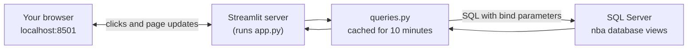

# Birthday Explorer: the local app

A website that runs on your own computer for exploring the NBA data: pick a player, filter his games, and see how he plays around his birthday. It reads straight from the `nba` database in SQL Server.

## Contents

1. [Opening the app](#opening-the-app)
2. [Using it](#using-it)
3. [How it works](#how-it-works)
4. [The files](#the-files)
5. [Security](#security)
6. [Troubleshooting](#troubleshooting)
7. [Ideas for improvements](#ideas-for-improvements)

---

## Opening the app

### Before the first time

1. **SQL Server must be running**, with the `nba` database loaded (see the main [README](../README.md)).
2. **Streamlit must be installed** in the project's virtual environment. It's in `requirements.txt`, so this covers it:

   ```powershell
   .venv\Scripts\python.exe -m pip install -r requirements.txt
   ```

3. **Run the models once**, so the Model tab has results to show (about 40 seconds; re-run after loading new data):

   ```powershell
   .venv\Scripts\python.exe src\models\run_models.py
   ```

   The app still works without this; the Model tab just tells you to run it.

### Every time

1. Open a terminal in the project folder (in PyCharm: the **Terminal** tab at the bottom).

   ```powershell
   cd C:\Users\andre\PycharmProjects\ajo\nba
   ```

2. Start the app:

   ```powershell
   .venv\Scripts\streamlit run app\app.py
   ```

3. Open **http://localhost:8501** in your browser. The terminal also prints this link.
4. To stop it, click in the terminal and press **Ctrl+C**.

Keep the terminal open while you use the app; closing it stops the website.

### Running it without SQL Server (the "deployed" way)

The app can read a **Parquet snapshot** of the database instead of SQL Server, using DuckDB. This is how it will run once deployed, so it's the way to test that on your PC.

1. Create or refresh the snapshot (about 15 seconds; SQL Server must be running for this step):

   ```powershell
   .venv\Scripts\python.exe src\run_job.py export
   ```

   This writes 7 files (about 16 MB) and a `manifest.json` to `data/`.

2. Start the app in Parquet mode:

   ```powershell
   $env:NBA_DATA_SOURCE = "parquet"
   .venv\Scripts\streamlit run app\app.py
   ```

   The sidebar shows **Data: Parquet snapshot from ...** so you can always tell which source is in use.

3. To go back to SQL Server in the same terminal: `$env:NBA_DATA_SOURCE = "sqlserver"` (or close the terminal; the setting only lasts for that window).

| `NBA_DATA_SOURCE` | Uses |
|---|---|
| not set, or `auto` | SQL Server if it answers, otherwise the Parquet snapshot. If SQL Server is off, the first page load waits about 15 seconds for it to time out |
| `sqlserver` | Always SQL Server |
| `parquet` | Always the snapshot in `data/` (or the folder in `NBA_DATA_DIR`) |

The snapshot doesn't update itself: re-run `export` after loading new data. `export` is also the last step of `run_job.py all`. Model results still come from `outputs/` either way.

**Tip:** if you edit `app.py` while the app is running, Streamlit notices. Click **Rerun** in the top-right corner of the page (or press **R**) to see the change.

---

## Using it

The app has two pages; switch between them at the top of the sidebar.

| Page | For |
|---|---|
| **Player explorer** | One player in depth: his games, his birthday effect, the models (everything below until "The Today page") |
| **Today** | One date: its games, whose birthday it is, and how those players have done on past birthdays |

### The sidebar

| Control | What it does |
|---|---|
| **Player** | Pick any player. Type to search. Team shown in brackets (FA = free agent) |
| **Seasons** | Which seasons to include |
| **Season type** | Regular season, playoffs, or both |
| **Birthday phase** | Before (1-3 days), on the birthday, after (1-3 days), other games |
| **Days from birthday** | Slider from −183 to +183. Negative = before the birthday, 0 = on it. Drag both ends to, say, −7 and +7 to see just the fortnight around it |
| **Location** | All, home or away games |
| **Result** | All games, wins or losses |
| **Stat** | Which stat the charts and the birthday-week cards use |

The filters apply to the header cards and the Birthday effect, Game log, Season by season and Missed games tabs. The **Model**, **League** and **Pipeline** tabs cover everyone, so they ignore them. The model section on a player's page also ignores them: it uses all his regular-season games.

### The header

- **Birthday**, **next birthday** (countdown in days; hover the ? icon for the exact date) and the age he **turns**.
- **Games in view**: how many games match the filters.
- **Birthday week vs other games** for the chosen stat, with the difference shown as a green or red arrow.
- **Birthday-week games** and **games on his birthday**.

### The tabs

| Tab | What's in it | Data comes from |
|---|---|---|
| **Birthday effect** | (1) Bar chart: his average for each day within two weeks of his birthday, compared with his average across all games in view. (2) Every game as a timeline, birthday games coloured. Scroll to zoom, drag to pan, double-click to reset. (3) Table of averages by birthday phase. (4) **What the model says about him:** his raw birthday-week effect, the model-adjusted one and the league's, with intervals | `dbo.v_player_game_features`, `outputs/player_effects.csv` |
| **Model** | League-wide results from `src/models`: a verdict banner, then for the chosen stat (5) before / on / after, (6) the change in the chance of playing, (7) day by day, (8) by the age he turns, and (9) a table of every stat. Has its own stat picker; ignores the sidebar filters | `outputs/*.csv` from `run_models.py` |
| **Game log** | Every game, newest first, with a **Birthday** column ("2 days before", "On birthday"). Choose column groups: box score, shooting, advanced, usage splits, context, tracking. **Birthday week only** switch. **Download as CSV** button. Click a column header to sort | `dbo.v_player_game_features` |
| **Season by season** | Each season's birthday-week averages against the rest of that season (regular season only) | `dbo.v_birthday_week_vs_season` |
| **Missed games** | Games his team played without him, counted by birthday phase | `dbo.v_player_missed_games` |
| **League** | Upcoming birthday-week games for every player (switch to show only games *on* the birthday), and the biggest birthday-week over- and under-performers, with a slider for the minimum number of games | `dbo.v_upcoming_birthday_week_games`, `dbo.v_birthday_week_vs_season` |
| **Pipeline** | The last 10 pipeline runs, and a **Clear cache and reload data** button | `etl.job_run` |

**Reading the charts:** a single player only has a handful of games on each day, so the bars jump around a lot. A big bar at day 0 for one player is usually luck. That's what the "What the model says about him" section is for: it shrinks his raw number towards the league's in proportion to how little evidence there is. The **Model** tab is the place to judge whether birthdays matter in general.

**Reading the Model tab:** each dot is an estimate and each line its 95% interval. If the line crosses zero, the data can't tell that result apart from no effect. Hover for the exact numbers, the number of games and the q-value (below 0.05 = significant after correcting for testing many things). The models themselves are explained in [src/models/README.md](../src/models/README.md).

---

### The Today page

Pick a date with the date box, step with **← Previous day** / **Next day →**, or jump back with **Today**.

| Section | What it shows |
|---|---|
| **Header cards** | Games scheduled, birthdays on the day, birthdays within 3 days either side, and how many of those players play that day |
| **Games** | Every game that date: tip-off (US Eastern), teams, type (preseason, cup…), status ("Final" once played), arena, city, and which birthday players are in it (with "1 day ago" / "in 2 days" when the birthday isn't that day). If there are no games, buttons jump to the nearest game days |
| **Birthdays within 3 days** | Every active player whose birthday is within 3 days either side of the date: team, birthday, **When** ("Today", "In 2 days", "1 day ago"), the age he turns, and his game if his team plays that day |
| **How they've played on past birthdays** | One panel per birthday player (open for those playing that day). Cards: birthday games, his average in them, his season averages, the difference. Chart: each birthday year, a dot per game (blue before, orange on, green after) against a grey line for his regular-season average that season. Table: every one of those games with the day of the week, minutes, points, field goals and threes (made, attempted, %), rebounds, assists and true shooting. Choose the stat, and **4 days either side of the birthday** or **On the birthday only** |

Things to know:

- **Dates are US dates**, as the NBA schedule uses them. From Australia, a US Monday-night game is Tuesday for you.
- **Teams are today's rosters.** On a past date, a player traded since then shows with his current team.
- **29 February birthdays** show on 28 February in non-leap years.
- **No games on a date in 2025-26?** That season's schedule isn't loaded yet: `run_job.py schedule --season 2025-26`.
- **"No games this close to his birthday"** is normal for summer birthdays (off-season) and early-to-mid October ones (preseason, not loaded).

## How it works



### Streamlit's model: the whole script reruns

[Streamlit](https://streamlit.io/) turns a Python script into a web page. The key idea:

**Every time you change anything (pick a player, move a slider, switch a filter), Streamlit runs `app.py` again from top to bottom.**

Each widget call both draws the widget *and* returns its current value:

```python
stat = st.sidebar.selectbox("Stat", list(STATS), format_func=lambda s: STATS[s][0])
```

On the first run, `stat` is the default (`"pts"`). When you pick "Rebounds", the script reruns and this same line returns `"reb"`. Everything below uses the new value automatically, with no callbacks or event handlers to write.

### Two data sources, one set of queries

Every query lives in [queries.py](queries.py) and goes through one function, `run_query()`:

- **SQL Server:** passes the query to `db.read_sql()`, as before.
- **Parquet:** opens an in-memory DuckDB database with one view per Parquet file. The files are named after the SQL objects (`dbo.player.parquet` becomes the view `dbo.player`), so **the same SQL text runs on both**. The only translation is the parameter style: DuckDB writes `$player_id` where SQL Server writes `:player_id`.

To keep the queries portable, they avoid SQL Server-only syntax: no `TOP`, and no `+` for joining text; those bits are done in pandas instead.

Which source to use is decided once per app process by `source()`, which is cached with `@st.cache_resource`. The **Clear cache and reload data** button clears that too, so it re-checks.

### Caching: why reruns are fast

Rerunning everything would mean querying SQL Server on every click. [queries.py](queries.py) prevents that:

```python
@st.cache_data(ttl=CACHE_SECONDS)
def player_games(player_id: int) -> pd.DataFrame:
    ...
```

`@st.cache_data` remembers the result for each set of arguments. The first time you pick LeBron, his games are fetched (about 1.4 seconds). After that, LeBron is instant until the cache expires after **10 minutes** (`ttl=600`). Filters don't re-query at all: they work on the cached DataFrame in pandas.

After loading new data with the pipeline, either wait 10 minutes or press **Clear cache and reload data** on the Pipeline tab.

### The flow of one run of `app.py`

1. **Load the player list** (cached) and draw the player picker.
2. **Load that player's games** (cached) from `dbo.v_player_game_features`. If there are none (e.g. a rookie whose games aren't loaded yet), show a message and `st.stop()`.
3. **Add helper columns**: the phase label ("On birthday") and the birthday note ("2 days before").
4. **Draw the filters and apply them** with a pandas mask:

   ```python
   mask = (
       games["season"].isin(seasons)
       & games["season_type"].isin(season_types)
       & games["phase_label"].isin(phases)
       & games["days_from_birthday"].between(*day_range)
   )
   filtered = games[mask]
   ```

   Each condition gives True/False per game; `&` combines them; `games[mask]` keeps the True rows.
5. **Draw the header**, including the countdown from `next_birthday()`. It handles 29 February birthdays by using 28 February in non-leap years.
6. **Draw the tabs.** Each tab is a `with tab_name:` block; everything inside it appears in that tab.

### Charts

Charts use **Altair**, which comes with Streamlit. A chart is built from layers:

```python
band = alt.Chart(...).mark_rect(...)    # the shaded birthday week
zero = alt.Chart(...).mark_rule(...)    # the zero line
bars = alt.Chart(by_day).mark_bar(...)  # the bars, with hover tooltips
st.altair_chart(band + zero + bars)      # "+" stacks the layers
```

Colours follow the project's data-viz palette: one blue for single-series charts; blue, orange and aqua for before / on / after; neutral grey for ordinary games. Phases are always named in the legend, not shown by colour alone.

---

## The files

| File | What it holds |
|---|---|
| [app.py](app.py) | The entry point and router: page settings, and the list of pages (`st.navigation`). Still the file you run |
| [player_explorer.py](player_explorer.py) | The Player explorer page: helper functions, the sidebar, the header, and one block per tab |
| [today.py](today.py) | The Today page |
| [common.py](common.py) | Shared by both pages: colours, the stat list, birthday helpers, and the data-source check |
| [queries.py](queries.py) | Every SQL query the app runs, each a cached function: `players()`, `player_games()`, `player_seasons()`, `player_missed_games()`, `upcoming_birthday_games()`, `league_birthday_leaders()`, `pipeline_status()` |
| [../src/export.py](../src/export.py) | The `export` job: writes the Parquet snapshot to `data/` |
| [model_results.py](model_results.py) | Reads the model results from `outputs/`. The cache is keyed on the files' modification time, so re-running the models shows up on the next page reload |
| [../.streamlit/config.toml](../.streamlit/config.toml) | App settings: address, port, theme colour, toolbar |

The app reuses the pipeline's database code: `queries.py` adds `src/` to the import path and calls `db.read_sql()`, so connection settings live in one place ([src/config.py](../src/config.py)).

### Things you might want to change

| To change | Edit |
|---|---|
| Stats in the chart pickers | `STATS` dict in `common.py` |
| Game log column groups | `LOG_GROUPS` and `LOG_LABELS` in `player_explorer.py` |
| Colours | `SERIES`, `NEUTRAL`, `PHASES` in `common.py` |
| Default player | `players["full_name"] == "LeBron James"` in `player_explorer.py` |
| Add a page | Write a new `.py` file in `app/` and add an `st.Page(...)` line to `app.py` |
| How long data is cached | `CACHE_SECONDS` in `queries.py` |
| Port | `port` in `.streamlit/config.toml` |
| A new query | Add a function with `@st.cache_data` to `queries.py`, using `:name` bind parameters |

---

## Security

| Setting | Where | Why |
|---|---|---|
| **Bind parameters** in every query | `queries.py` | The selected player reaches SQL as `:player_id`, sent separately from the SQL text, so nothing chosen in the app can alter a query (no SQL injection) |
| **Localhost only** | `address = "localhost"` in `config.toml` | Only this computer can open the app. Without it, anyone on the same Wi-Fi could reach port 8501 |
| **No usage statistics** | `gatherUsageStats = false` | Streamlit doesn't send usage data about the app |
| **Windows login to SQL Server** | `src/db.py` | No password stored anywhere |
| **Read-only use** | The app only runs `SELECT` queries | It can't change the data (though the Windows login itself could; a read-only SQL login would enforce this) |

---

## Troubleshooting

| Problem | Fix |
|---|---|
| `'streamlit' is not recognized` | Use the full path: `.venv\Scripts\streamlit run app\app.py` |
| `ModuleNotFoundError: No module named 'streamlit'` | Install it: `.venv\Scripts\python.exe -m pip install -r requirements.txt` |
| Page shows a **Login failed** or connection error | SQL Server isn't running, or the `nba` database doesn't exist. Check in SSMS |
| **Port 8501 is already in use** | The app is already running in another terminal; use that one, or stop it with Ctrl+C. Or change `port` in `config.toml` |
| A player shows **"No games loaded"** | His games aren't in the database yet (often rookies). Run the `players` and `game_logs` jobs for the current season |
| New data doesn't appear | It's cached for 10 minutes. Press **Clear cache and reload data** on the Pipeline tab |
| "SQL Server isn't available and there is no Parquet snapshot yet" | Start SQL Server, or run the `export` job on a computer that has it |
| Sidebar says Parquet when you expected SQL Server | SQL Server didn't answer, so `auto` fell back. Start it and press **Clear cache and reload data** on the Pipeline tab |
| First page load takes ~15 seconds | `auto` mode is waiting for an unreachable SQL Server. Set `$env:NBA_DATA_SOURCE = "parquet"` |
| Model tab says "No model results yet" | Run `.venv\Scripts\python.exe src\models\run_models.py`, then press R |
| Model results look out of date | The models don't re-run by themselves. Run `run_models.py` again after loading new data |
| "Tracking" columns are empty | The tracking job hasn't loaded those dates yet (`run_job.py tracking`) |
| The browser didn't open | It isn't meant to (`headless = true`). Go to http://localhost:8501 yourself |

---

## Ideas for improvements

### Features

1. **Compare two players** side by side.
2. **Team view**: every player on a team, with whose birthday is coming up.
3. **Birthday calendar**: a month grid of upcoming birthday games.
4. **Player photos**: the NBA CDN serves headshots by player id.
5. **Prediction**: once the XGBoost model exists, show a predicted line for his next birthday game.

### Engineering

6. **Tests** with Streamlit's `AppTest` (runs the app without a browser), in `tests/test_app.py`, so a change that breaks a tab is caught automatically.
7. **Split `app.py`** into one module per tab as it grows.
8. **Read-only SQL login** for the app, so it physically can't change data.
9. ~~**Parquet + DuckDB instead of SQL Server**~~ Done: the Parquet data source. Next for deployment: commit `data/` (remove it from `.gitignore`) and deploy to Streamlit Community Cloud with `NBA_DATA_SOURCE=parquet`, or upload the files to S3 for the AWS plan.
10. **Docker image** for the app, the next cloud step: one command to run it anywhere.
