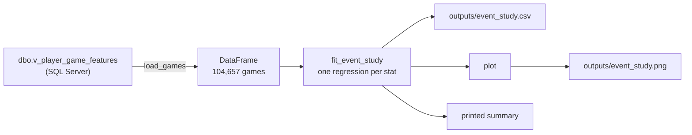

# Models: does a birthday change how a player performs?

This folder holds the statistical models. There are five, all run by one command, and the Birthday Explorer app shows their results (the **Model** tab, and "What the model says about him" on each player's page). This page explains what they do, how the code works, what they found, and what to improve next.

For the bigger plan (which other models to build and why), see [ROADMAP.md](../../ROADMAP.md#models).

## Contents

1. [Running it](#running-it)
2. [What an event study is](#what-an-event-study-is)
3. [How the code works](#how-the-code-works)
4. [The other models](#the-other-models)
5. [What they found](#what-they-found)
6. [How to read the charts](#how-to-read-the-charts)
7. [Limitations](#limitations)
8. [Improvements to make](#improvements-to-make)

---

## Running it

From the project folder, with SQL Server running:

```powershell
.venv\Scripts\python.exe src\models\run_models.py
```

It takes about 40 seconds and writes to `outputs/` (not committed to git). The app reads these files, so **re-run this after loading new data**, then press R in the app.

| File | Contents |
|---|---|
| `event_study.csv` / `.png` | Each stat on each day from 7 days before the birthday to 7 days after |
| `phase_effects.csv` | Each stat before (1-3 days), on, and after (1-3 days) the birthday |
| `phase_by_age.csv` | The same, split by the age the player turns: under 25, 25-29, 30+ |
| `availability.csv` | The change in the chance of playing at all |
| `player_effects.csv` | Each player's own birthday-week effect, raw and adjusted for small samples |
| `model_info.json` | When the models ran, on how many games, which stats and controls |

Every estimate comes with a 95% interval, a p-value and a **q-value** (the p-value corrected for testing many things at once). It prints a summary in the terminal too.

`event_study.py` can still be run on its own, but `run_models.py` loads the data once and runs everything.

Needs `statsmodels` and `matplotlib` (both in `requirements.txt`).

---

## What an event study is

An **event study** asks: around an event (here, a birthday), does something change, and when?

Instead of one "birthday week vs rest" comparison, it estimates a separate number for **each day** from −7 to +7. That shows the *shape* of any effect, which is what separates the two explanations being tested:

| Explanation | What the chart would show |
|---|---|
| **Teammates feed him** | Usage and shot share spike at day 0 |
| **He partied and is tired** | Shooting efficiency and minutes dip at day +1 or +2 |
| **No effect** | Dots scattered around zero, with the birthday week looking like any other days |

### The model, in one line

```
stat = player-season baseline + week of season + controls + (one term for each day from −7 to +7) + noise
```

| Part | What it does |
|---|---|
| **Player-season baseline** ("fixed effects") | Each player is compared only with **himself in the same season**. LeBron's birthday game is compared with LeBron's other games that season, never with a bench player's |
| **Week of season** | Birthdays in February fall at a different stage of the schedule (trade deadline, tanking, fatigue) than birthdays in November. This term absorbs that |
| **Controls** | Home or away, back-to-back, key teammates out, top scorer out, opponent's defensive rating so far. Birthdays are near-random, so these barely move the estimates, but they soak up noise and narrow the intervals |
| **Day terms** | The numbers we want. Day 0's term is "how much better or worse than his usual, on his birthday" |
| **Baseline days** | Games more than 7 days from a birthday have no day term, so every estimate is measured against them |

### Why a regression and not XGBoost?

The question is "how big is the birthday effect, and is it real?". A regression gives a number with a **confidence interval** ("+0.25 points, somewhere between −0.52 and +1.01"). XGBoost is built to predict, not to measure an effect with an interval. See the roadmap for where XGBoost fits later.

### Why birthdays suit this

A birthday is fixed at birth: it can't be caused by a player's form, injuries or opponents. That makes the comparison close to a natural experiment, so a simple within-player model is close to a fair test.

---

## How the code works

| File | Role |
|---|---|
| [run_models.py](run_models.py) | Runs every model, saves every output. **The one to run** |
| [data.py](data.py) | Loads games (and, for the availability model, missed games) from SQL Server |
| [outcomes.py](outcomes.py) | The stats to test (`OUTCOMES`) and the controls (`CONTROLS`). Tracking stats join automatically once 5,000+ games have them |
| [fixed_effects.py](fixed_effects.py) | Shared regression machinery: demeaning, fitting with clustered errors, q-values |
| [event_study.py](event_study.py) | The day-by-day model and its PNG chart |
| [phase_models.py](phase_models.py) | Before / on / after, by age, availability, and per-player effects |

The walkthrough below follows the event study; the other models reuse the same pieces.



### Step 1: load the data ([data.py](data.py))

```python
sys.path.insert(0, str(Path(__file__).resolve().parent.parent))
```

The models live one folder below `src/`, so this line lets them `import db` and `import config` like the pipeline jobs do.

`load_games(columns)`:

1. Selects the requested stats, plus the basics (`player_id`, `season`, `game_date`, `days_from_birthday`, `birthday_phase`) from `dbo.v_player_game_features`.
2. Keeps only **regular-season games he actually played** (`minutes > 0`). Playoffs are different in intensity and only happen for some teams.
3. Adds `week_of_season`: whole weeks since that season's first game.

### Step 2: fit one regression per stat ([event_study.py](event_study.py), `fit_event_study`)

```python
OUTCOMES = {
    "pts":     ("Points", "points", 1, "Overall"),
    "usg_pct": ("Usage rate", "% points", 100, "Teammates feed him"),
    ...
}
```

A dictionary (in [outcomes.py](outcomes.py)) of the stats to test: column → (label, unit, multiplier, which explanation it tests). Fractions like usage (0.25) are multiplied by 100, so results read in percentage points.

Inside `fit_event_study(df, outcome)`:

**a. Build the day indicators (dummy variables).**

```python
X = pd.DataFrame({f"day_{d}": (data["days_from_birthday"] == d).astype(float) for d in days}, ...)
```

15 columns, `day_-7` to `day_7`. Each is 1 if the game was played on that day relative to the birthday, otherwise 0.

**b. Add week-of-season indicators.**

```python
weeks = pd.get_dummies(data["week_of_season"], prefix="week", drop_first=True, dtype=float)
```

One column per week. `drop_first=True` leaves one week out as the reference; otherwise the columns would always add up to 1 and the model couldn't be solved.

The controls from `control_matrix()` are added alongside, with gaps filled (e.g. no back-to-back flag for a player's first game of the season).

**c. Fixed effects by "demeaning".**

```python
group = data["player_id"].astype(str) + "_" + data["season"]
y_within = y - y.groupby(group).transform("mean")
X_within = X - X.groupby(group).transform("mean")
```

Giving each of the ~1,900 player-seasons its own intercept would mean 1,900 extra columns. Subtracting each player-season's average from every column gives **exactly the same estimates** with no extra columns. After demeaning, a game's value means "how far above or below his own average that season". This trick is called the **within transformation**.

**d. Fit, with clustered standard errors.**

```python
model = sm.OLS(y_within, X_within).fit(cov_type="cluster", cov_kwds={"groups": ...player_id...})
```

- `sm.OLS` is ordinary least squares, a standard linear regression.
- **Clustered standard errors**: one player's games aren't independent of each other (a hot streak spans several games). Clustering by player widens the confidence intervals to account for that, so results don't look more certain than they are.

**e. Collect the day terms.** For each day: the estimate, the 95% interval, the p-value and the number of games.

### Step 3: chart and save (`plot`, `main`)

- A 2 × 3 grid, one panel per stat, each with its own scale.
- Colours come from the project's data-viz palette: one blue for the estimates, neutral greys for the grid, zero line and birthday-week shading.
- `main()` loops over every stat, combines the results, saves the CSV and PNG, and prints days 0, +1 and +2.

---

## The other models

All in [phase_models.py](phase_models.py), all with player-season fixed effects, week of season and clustered errors.

| Model | Function | Question | How |
|---|---|---|---|
| **Before / on / after** | `phase_effects` | Does each stat change in the 3 days before, on the day, or the 3 days after? | Same as the event study, but three phase terms instead of fifteen day terms. Each phase has hundreds of games, so the intervals are narrower, and there are far fewer estimates to be fooled by |
| **By age** | `phase_by_age` | Does a 22nd birthday play differently from a 34th? | One term per phase *per age group* ("interaction terms"). Age group is the age the player **turns** at that birthday |
| **Did he play?** | `availability` | Does a hangover show up as sitting out rather than playing badly? | Every team game while he was on the team, `played` = 1 or 0 (from `v_player_missed_games`). A "linear probability model": the estimates are percentage-point changes in the chance of playing |
| **Per-player effects** | `player_effects` | Does *this* player play differently in his birthday week? | A simple hierarchical ("empirical Bayes") model; see below |

### Per-player effects: shrinkage

A player has only 2-4 birthday-week games a season, so his raw birthday-week average is mostly luck. The model combines his own number with the league's:

```
adjusted = league + weight × (his raw number − league)
weight   = real differences between players / (real differences + his noise ÷ his games)
```

- **His raw number:** his birthday-week games compared with his games in the **surrounding month** of the same season. (A whole-season comparison would mistake role changes for a birthday effect: a rookie whose minutes grow through the year would look like he plays more on his late-season birthday.)
- **His noise:** how much *his* games vary from one to the next. A bench player's minutes swing far more than a star's.
- **Real differences between players:** how much more the players' raw numbers vary than luck alone would produce.

If players' birthday effects really differ, the weight is high for players with many birthday games and their own number mostly stands. If they don't, the weight is zero and every player's adjusted number is the league's.

This is the "Bayesian hierarchical model" idea from the roadmap in its simplest form. PyMC would do the same thing with full uncertainty.

### Multiple-comparison correction

Testing 9 stats × 15 days means some estimates look significant purely by chance. `add_q_values()` in [fixed_effects.py](fixed_effects.py) applies the **Benjamini-Hochberg** correction: a result counts as significant only if its q-value is below 0.05, which keeps false alarms to about 5% of the "significant" results.

---

## What they found

Latest run: **104,657 regular-season games, 421 players, 2017-18 to 2024-25.** 9 stats (the 6 tracking stats wait for the tracking load).

### Before / on / after

| Stat | 1-3 days before | On the birthday | 1-3 days after |
|---|---|---|---|
| Points | +0.20 (−0.33 to +0.74) | +0.17 (−0.59 to +0.92) | +0.09 (−0.34 to +0.52) |
| Usage rate (% pts) | −0.05 (−0.52 to +0.43) | +0.06 (−0.68 to +0.79) | +0.05 (−0.40 to +0.51) |
| Team shot share (% pts) | +0.01 (−0.59 to +0.61) | +0.01 (−0.84 to +0.86) | +0.13 (−0.43 to +0.69) |
| % of made shots assisted (% pts) | +0.16 (−2.06 to +2.37) | −1.24 (−4.69 to +2.22) | +1.63 (−0.51 to +3.76) |
| True shooting (% pts) | −0.44 (−2.19 to +1.32) | −1.01 (−3.72 to +1.71) | +0.67 (−0.84 to +2.18) |
| Minutes | +0.21 (−0.26 to +0.69) | +0.01 (−0.75 to +0.77) | +0.17 (−0.32 to +0.65) |
| Turnovers | +0.03 (−0.06 to +0.11) | −0.03 (−0.18 to +0.12) | −0.02 (−0.10 to +0.05) |

Differences from the player's own average that season; brackets are 95% intervals. Rebounds and assists (also modelled) are equally flat.

**None of the 27 estimates is significant** after the correction. Every interval includes zero.

### The other results

- **Did he play?** The chance of playing is 1.7 points lower on the birthday and 1.8 points lower in the 3 days after, against a normal rate of 78%. Neither is significant, so the "tired players sit out" loophole doesn't hide an effect, at least not one this data can see.
- **By age:** no age group stands out once the wide intervals are taken into account (the 30+ group has only about 30 games on the day itself).
- **Per player:** for points, usage, shot share, shooting, rebounds and assists, players' birthday-week numbers vary **no more than luck would produce**, so every player's adjusted effect equals the league's. Only minutes shows a small spread between players (about ±1 minute).
- **Worth watching:** in the day-by-day model, **the share of made shots that were assisted is 7.1 points higher two days after the birthday (q = 0.02)**, and true shooting is up the same day (not significant on its own). It is a single day, it doesn't appear in the pooled "after" phase, and nothing similar happens on the days around it, so it is more likely a fluke than a pattern. More seasons of data (2025-26) will show whether it holds up.

### Conclusion

**No birthday effect.** Neither "teammates feed him" nor "partied and tired" shows up: not in performance, not in playing time, not for any age group, and not for individual players beyond what luck explains. A well-supported "no effect" is a real finding, and it's what you'd expect from professionals paid to perform every night.

---

## How to read the charts

The same rules apply to the PNG and to every chart on the app's Model tab.

- **Dot:** the best estimate: how far above (positive) or below (negative) the player's usual level.
- **Vertical line:** the 95% confidence interval, the range the true value very likely falls in. **If the line crosses zero, the data can't rule out "no difference".**
- **Shaded area:** the birthday week (3 days either side).
- **Each panel has its own scale.** Compare shapes across panels, not heights.

A real effect would look like a cluster of dots well clear of zero at the expected days (0 for "feed him", +1/+2 for "tired"), not a single dot that happens to poke out.

---

## Limitations

| Limitation | Why it matters |
|---|---|
| **Only games played** (`minutes > 0`) | If tired players sit out the day after their birthday, those games vanish from the performance models. The availability model now checks this directly and finds no significant change |
| **Small samples per day** | About 260-280 games per day. That's why the intervals are wide: an effect smaller than about ±0.7 points can't be detected |
| **Many comparisons** | Corrected with Benjamini-Hochberg q-values. The correction is applied within each model's results, not across all five models together |
| **Active players only** | Older seasons contain only players still in the league today (a survivor sample) |
| **Off-season birthdays** | Players born roughly July to September have no birthday-week regular-season games, so they contribute nothing to the day terms |
| **No tracking stats yet** | Distance, speed and hustle (the most direct "tired" signals) are only loaded for 3 dates |
| **Degrees of freedom** | The within transformation is done by hand, so `statsmodels` doesn't know ~1,900 averages were removed. With 100,000+ games the effect on the intervals is tiny, but `linearmodels.PanelOLS` handles it exactly |
| **Linear model for counts** | Turnovers are counts (0, 1, 2…); a linear model is fine for averages but Poisson/negative binomial is more correct |

---

## Improvements to make

Roughly in priority order.

**Done in this round:** before / on / after model (was 5), multiple-comparison correction (6), controls (7), age interactions (part of 8), missed games (4, as a linear probability model), per-player shrinkage (a simple version of 10), and the app tab (15). The list below keeps the original numbering.

### Data

1. **Load the tracking data** (`run_job.py tracking`), then add `dist_miles`, `avg_speed`, `deflections`, `contested_shots`, `passes_received` and `touches` to `OUTCOMES`. That's the real test of both explanations.
2. **Load 2025-26** (game logs, usage, team logs) for another season of birthday games and narrower intervals.
3. **Add preseason** as a separate analysis, so October birthdays (e.g. Josh Giddey, 10 October) are covered.

### Model

4. ~~**Missed games.**~~ Done (`availability`). A true logistic regression would be the stricter version.
5. ~~**Before / on / after version.**~~ Done (`phase_effects`).
6. ~~**Correct for multiple comparisons.**~~ Done (q-values everywhere).
7. ~~**More controls.**~~ Done for home/away, back-to-back, teammates out and opponent strength. Still to add: `days_rest` and `is_starter` (needs the tracking load).
8. **Who is affected?** Age is done (`phase_by_age`). Still to try: home vs away, a night off after the birthday, late tip-offs.
8b. **Follow up the day +2 assisted-shots result** once 2025-26 is loaded.
9. **Right model for each stat.** Poisson / negative binomial for turnovers and deflections; `linearmodels.PanelOLS` for exact fixed-effects standard errors.

### Next models (from the roadmap)

10. **Full Bayesian hierarchical model** (PyMC / Bambi). The per-player shrinkage is a simple version; PyMC would add full uncertainty and let the effect vary by stat and age at once.
11. **Prediction ladder** for next-game points: season average → Ridge → random forest → XGBoost, with and without birthday features, explained with SHAP.

### Code quality

12. **Tests** with `pytest`: e.g. a tiny made-up dataset where the birthday effect is known (+2 points at day 0) and the model must recover it.
13. **Command-line options** with `argparse` (window size, stats, seasons), as `run_job.py` does.
14. **Cache the data** to a Parquet file so repeated runs don't re-query SQL Server. This is also a step towards the cloud plan.
15. ~~**Show the results in the app.**~~ Done: the Model tab and the per-player section.
16. **Run the models automatically** after the daily pipeline, so the app is never out of date.
